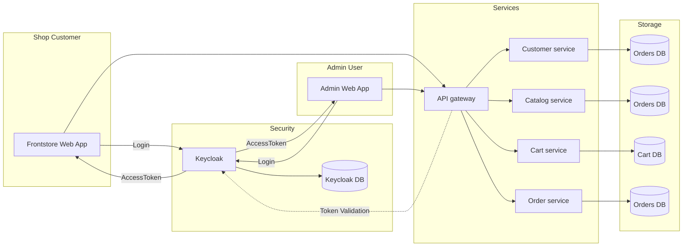

# BIG-SHOP

🚧Under construction🚧

## Architecture
 This work is a portfolio example, currently in development

## Run local dev

### Prerequisites

Docker and compose (Docker Desktop).

### Run docker compose

Launch all containers

    cd infra
    cp .env.example .env        # replace all vars, passwords
    docker compose up -d

Keycloak is in dev mode and initialized with keycloak/realms/*.json configurations.

### Initialize Keycloak (realms)

Run the configured script bootstrap-admin.sh to create the first admin user in Keycloak:

    ./keycloak/bootstrap-admin.sh

If having trouble on creation and need to retry, just go to the Keycloak console http://localhost:8180/ and delete the user in the realm.
Then run the script again.