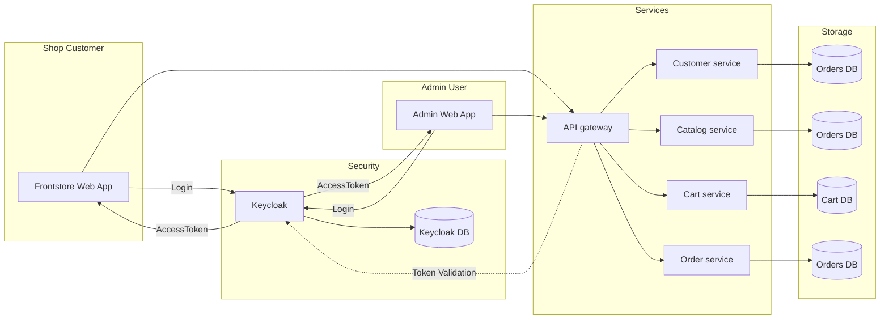

# BIG-SHOP

🚧Under construction🚧

## Architecture
 This work is a portfolio example, currently in development




## 👩‍💻 Tech Stack

- **Spring & SpringBoot**: A powerfull Java framework and a great tooling library.
- **Keycloak**: Server used to authenticate users and applications (IAM).
- **Docker**: Container (Bundled software) running server.
- **Liquibase**: Java module to manage database versioning.
- **PostgreSQL**: SQL database server.
- **Maven**: Java dependencies manager and task runner.

## 📦 Getting Started

### 🚀 Prerequisites

 - Java 25 or later
 - Maven
 - Docker (Docker Desktop).

### 🛠️ Installation

1) **Clone the repository:**

    ```bash
    git clone https://github.com/fcazalet/big-shop.git
    cd big-shop
   ```
   
2) **Set up environment variables:**

    ```bash
    cd infra
    cp .env.example .env        # replace all vars, passwords
    ```

3) **Launch containers:**

This will start PosgreSQL database, keycloak (IAM), Mailpit and Nginx.

Run in ``infra/`` directory:

    ```bash
    cd infra
    docker compose up -d
    ```

Keycloak is in dev mode and initialized with keycloak/realms/*.json configurations.

4) **Initialize Keycloak (admin users):**

Run the configured script bootstrap-admin.sh to create the first admin user in Keycloak:

    ```bash
    ./keycloak/bootstrap-admin.sh
    ```

If having trouble on creation and need to retry, just go to the Keycloak console http://localhost:8180/ and delete the user in the realm.
Then run the script again.

5) **Build Gateway & Services**

Go to ``backend/`` directory and build project:

    ```bash
    cd backend/
    mvn clean install
    ```

Then launch gateway and services:

## 📖 Usage

### ✔ Running the Website

- **Development mode:**

    ```bash
    # One single bash script to launch them all
    ./start-all-services.sh
    ```

### 📃 API Documentation

Under construction

## 🐛 Issues

If you encounter any issues while using or setting up the project, please check the [Issues]() section to see if it has already been reported. If not, feel free to open a new issue detailing the problem.

When reporting an issue, please include:

- A clear and descriptive title.
- A detailed description of the problem.
- Steps to reproduce the issue.
- Any relevant logs or screenshots.
- The environment in which the issue occurs (OS, browser, Java version, etc.).

## 📜 License

Distributed under the MIT License. See [License](/LICENSE) for more information.
